# ISH TOPDIM — "premium" ko'rinish (2026-10, 3-qism)

Egasining so'rovi: kirganda bron qilish mini-ilovasidek bo'lsin; e'lon joylash va CV yaratish tugmalari bo'rtib, yaltirab
tursin; AI qidiruv qimirlab tursin; "AI qilgandek", havaskorona ko'rinmasin — odam kirib, ishonib, ish topadigan darajada
professional bo'lsin; odamlarni jalb qiladigan fishkalar.

## 1. Nima uchun "AI qilgandek" ko'rinardi (oldin)

| Belgi | Misol |
|---|---|
| Hamma narsa bir xil tekis oq karta, och fon, bitta ko'k — brend "yuzi" yo'q | bosh sahifa, kirish ekranlari (`before-*`) |
| Asosiy amallar oddiy havola yoki kichik tugma: "E'lon berish", "CV" ko'zga tashlanmaydi | ish qidiruvchi bosh sahifasi |
| Birinchi ochilish (til, rol) — shablon ko'rinishi: kulrang doira ichida belgi | `before-0-start-*` |
| AI qidiruv — oddiy matnli tugma, "jonli" emas | `before-2-seeker-home-390` |
| Tugmalarda chuqurlik yo'q (tekis to'rtburchak) | butun ilova |

## 2. Nima o'zgardi

**Dizayn qatlami** (`globals.css`, `docs/BRAND_UI_GUIDE.md` §1.1): chuqur ko'k sarlavha sirti (`.hero-surface`), bo'rtib turadigan
tugmalar (`.btn-3d` — barcha asosiy tugmalar), ko'k sirt ustidagi oq tugma (`.btn-light`), yaltirash (`.shine`), aylanib
turadigan AI chegarasi (`.ai-glow`), yaltiroq rangli belgilar (`.badge-*`), ko'tarilgan plitkalar, menyudan bo'rtib chiqadigan
markaziy tugma (`.nav-fab`). Komponentlarda xom gradient/hex hali ham yo'q — brend qo'riqchisi o'zgarmadi; yangi ranglar
kontrast testiga qo'shildi. Radius biroz kattalashdi (zamonaviyroq). Harakat `prefers-reduced-motion` da o'chadi.

**Bosh ekranlar — mini-ilova uslubi:**
- **Ish qidiruvchi:** ko'k sarlavha (salomlashuv ismi bilan, "O'zingizga mos ishni toping", bugungi haqiqiy son), oq qidiruv
  kartasi, **jonli AI qatori** (rangli chegara aylanadi, belgi yaltiraydi, misollar o'zi yozilib-o'chadi) va "Filtrlar";
  sarlavha ustiga chiqib turadigan **8 ta xizmat**: CV yaratish (kirgan bo'lsa — "Mening CV'im"), Kunlik ish, Yaqin atrofda,
  Masofaviy, Tajribasiz, Talabalar, Telegram xabar, Barcha kasblar. Kompyuterda o'ngda haqiqiy raqamlar paneli. Telefonda
  birinchi vakansiya baribir birinchi ekranda (test).
- **Ish beruvchi (panel):** sarlavhada logotip, salomlashuv, tasdiq holati, oq yaltiroq **"Vakansiya joylash"**, jonli AI nomzod
  qidiruvi; xizmatlar: (AI bilan e'lon), Arizalar, Nomzodlar, Kunlik ishchi, Tajribali, Yaqin atrofda, Telegram xabar, Kompaniya.
- **Ish beruvchi (mehmon / profil yo'q):** shu uslubdagi sarlavha va 4 ta xizmat.
- **Pastki menyu:** o'rtada bo'rtib, yaltirab turadigan **"E'lon"** (ish qidiruvchi — o'zi haqida e'lon/CV, ish beruvchi — vakansiya).
  Kompyuterda — yuqori paneldagi yaltiroq "E'lon berish" / "Vakansiya joylash".
- **Mehmon bosh sahifasi:** ko'k sarlavha, sariq urg'uli sarlavha, oq yaltiroq "Ish qidiraman" va shaffof "Xodim qidiraman".
- **Birinchi ochilish:** til ekranida brend kartasi (belgi, "Ish topdim", shior, bugungi haqiqiy son); rol kartalarida yaltiroq
  belgilar; tanishtiruv tasvirlari brend ramkasida; barcha kirish belgilari — "ilova belgisi" uslubida.

**Fishka — "Gapirib bering":** AI bilan rezyume/vakansiya tuzishda yozish shart emas — "Gapirib berish" tugmasi, aytilgani matnga
yoziladi, AI maydonlarni to'ldiradi (brauzer qo'llasa; ovoz serverga yuborilmaydi). AI qidiruvda ham mikrofon bor (2-qism).

## 3. Oldin / keyin (`docs/screenshots/premium-2026-10/`, skript: `e2e/screens/premium.shots.ts`)

| Ekran | Oldin | Keyin |
|---|---|---|
| Til (birinchi ochilish) | 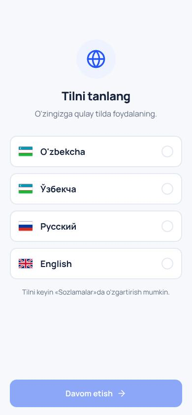 | 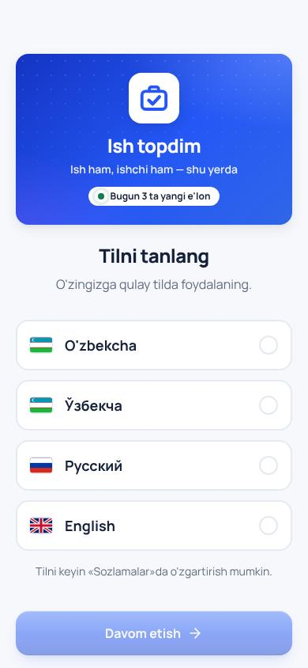 |
| Tanishtiruv | 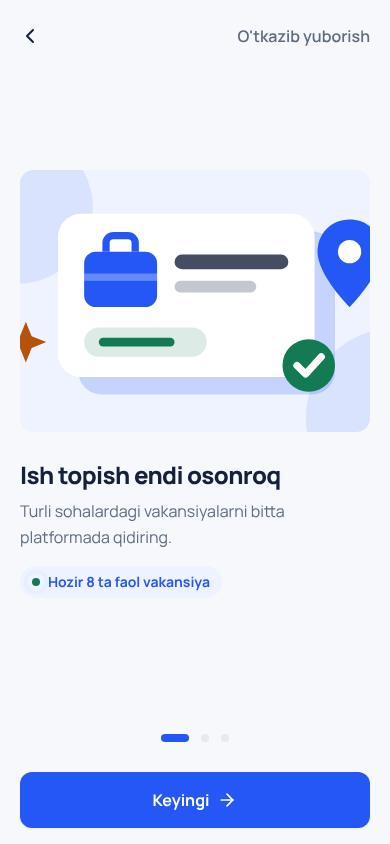 | 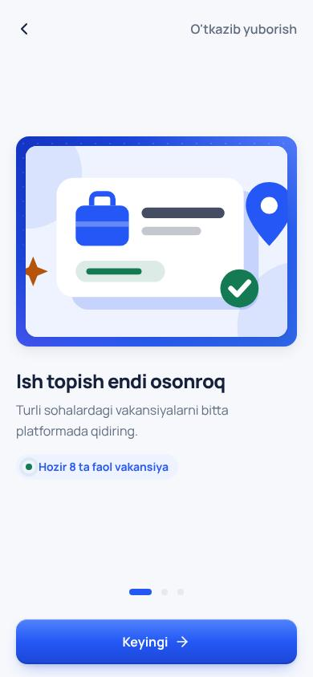 |
| Rol | 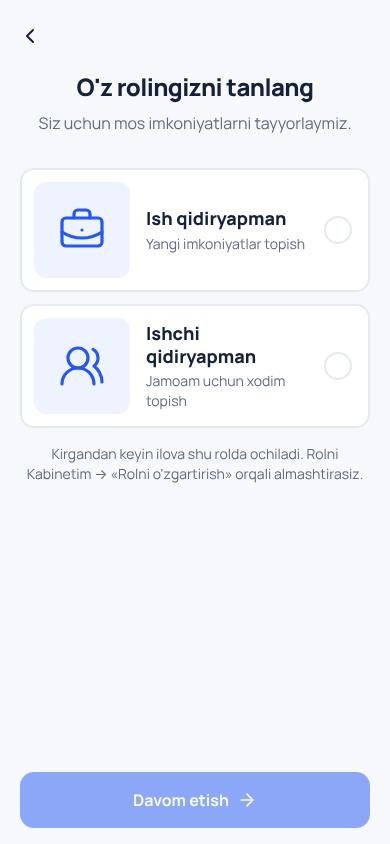 | 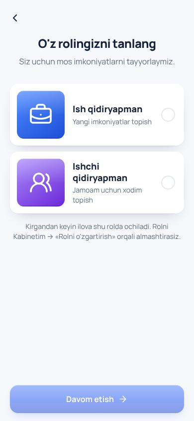 |
| Ish qidiruvchi (telefon) | 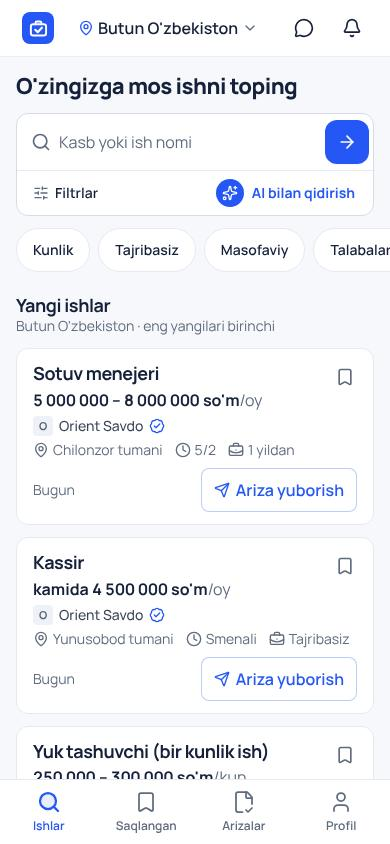 | 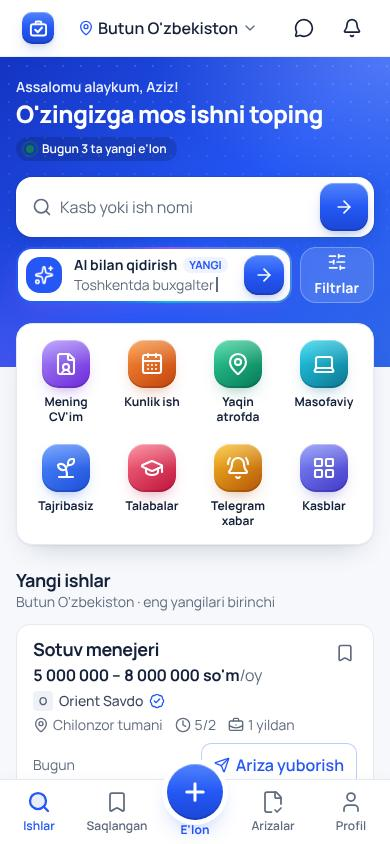 |
| Ish beruvchi (telefon) | 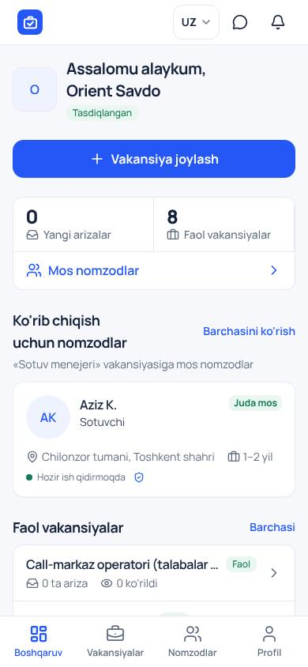 | 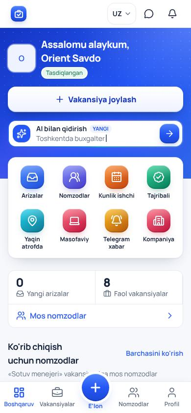 |
| Mehmon (telefon) | 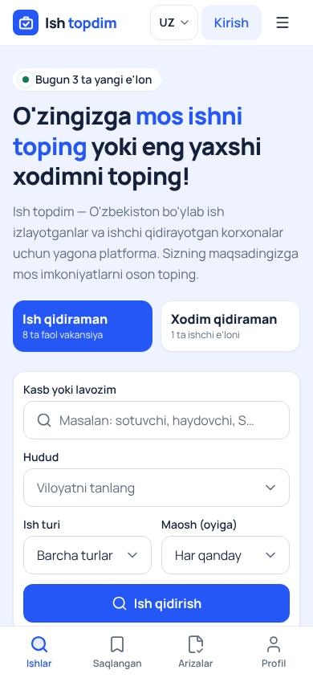 | 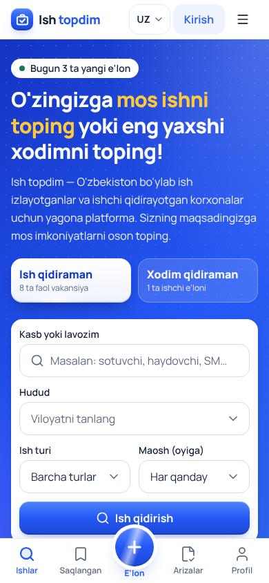 |
| Ish qidiruvchi (kompyuter) | 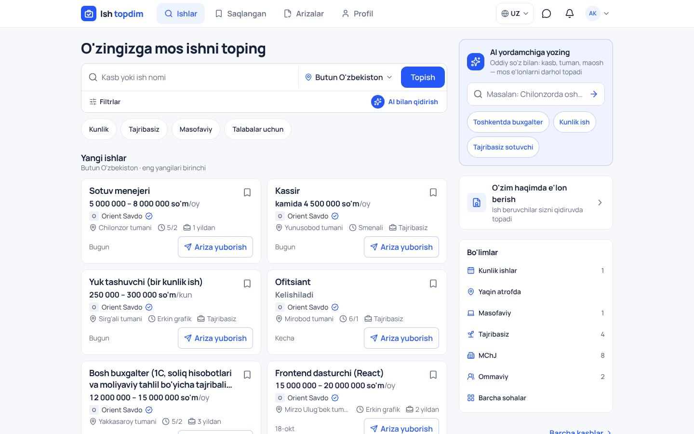 | 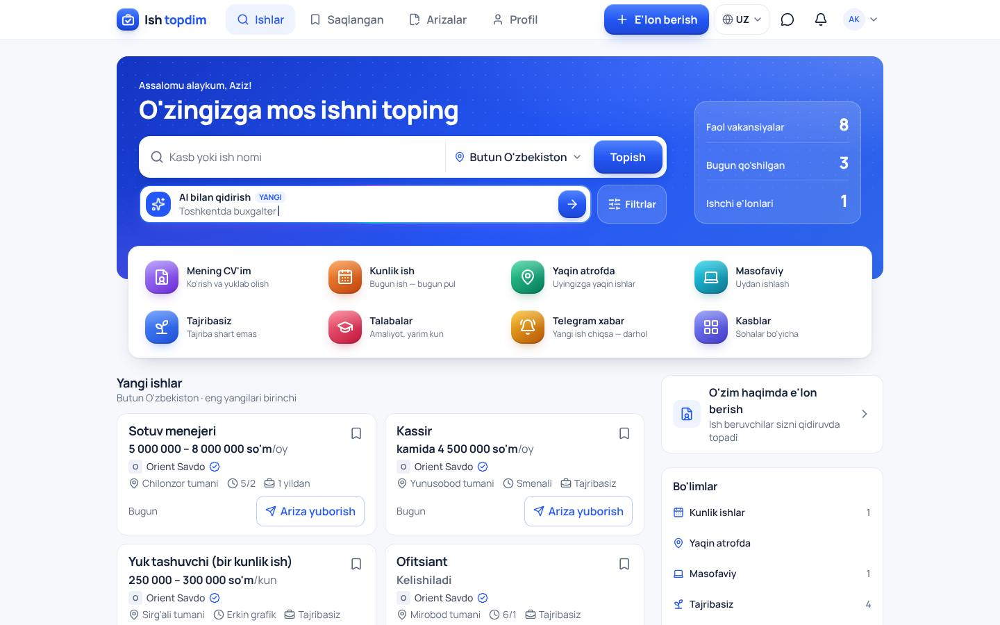 |
| Ish beruvchi (kompyuter) | 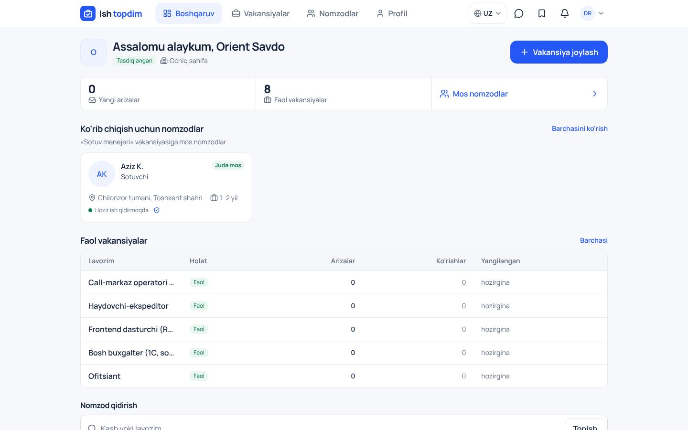 | 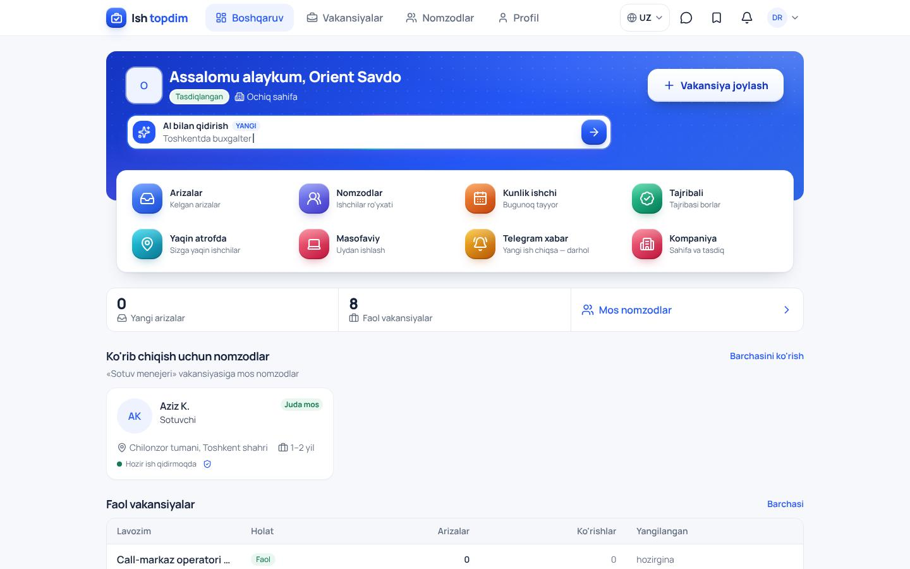 |
| Mehmon (kompyuter) | 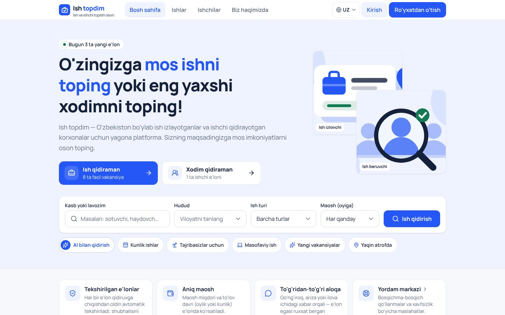 | 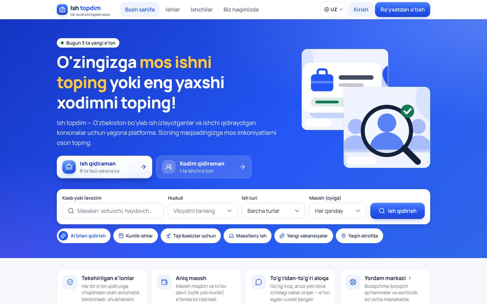 |

## 4. Keyingi fishkalar (taklif, hali qilinmagan)

1. **Haqiqiy fotosuratlar:** admin → "Kirish ekranlari" va kasb rasmlari (`IMAGE_GEN_API_KEY`) yoqilsa, kartalar va sarlavhalar
   jonli suratlar bilan chiqadi — eng katta "professional" farq. Kalit qo'yilishi kifoya.
2. **"Bugun ish" xaritasi:** kunlik ishlar xaritada (yaqin atrofda) — qurilish, yuk tashish uchun.
3. **Bir bosishda Telegram orqali ariza** va ish beruvchiga darhol xabar (bot bor — oqimni qisqartirish).
4. **Maosh ko'rsatkichi:** "Bu kasb bo'yicha Toshkentda o'rtacha maosh" — faqat bazadagi haqiqiy e'lonlardan.
5. **Ishonch belgilari:** tasdiqlangan kompaniya, "javob beradi" (o'rtacha javob vaqti), shikoyatlar soni.
