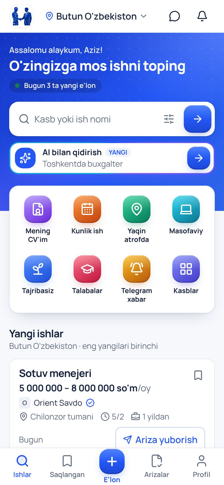
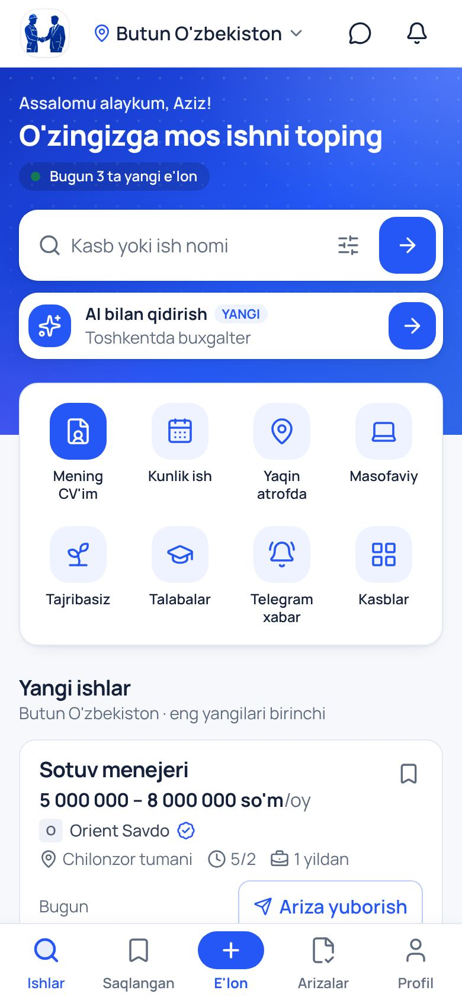
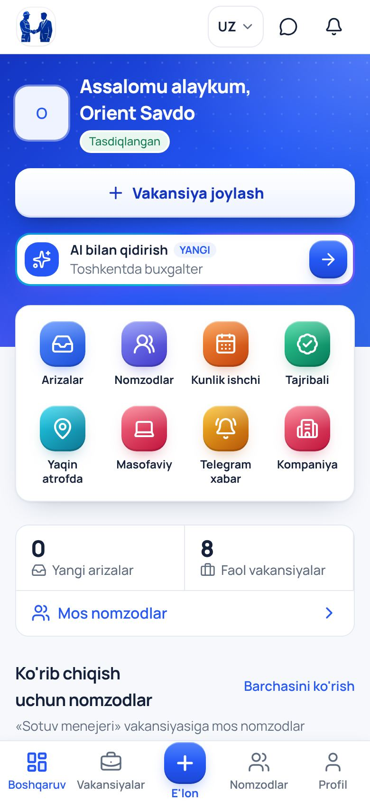
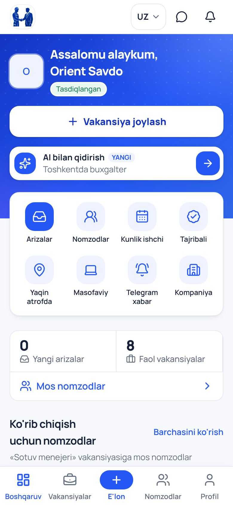
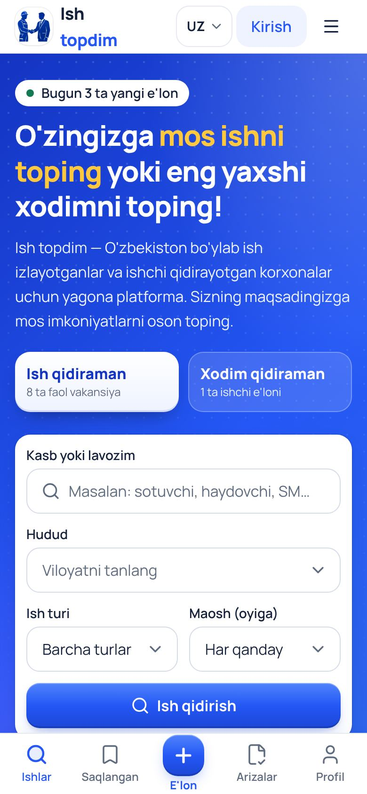
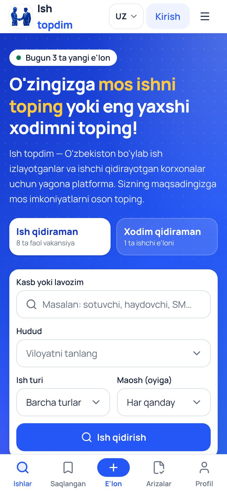
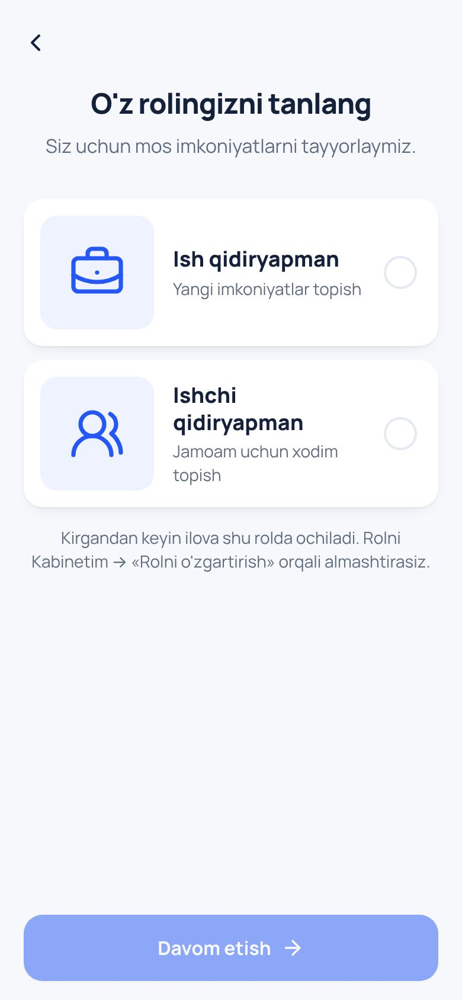
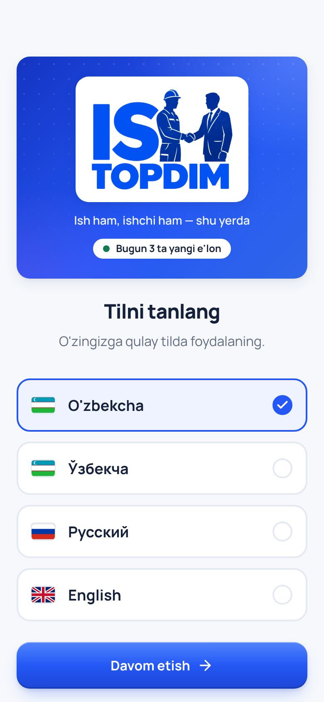
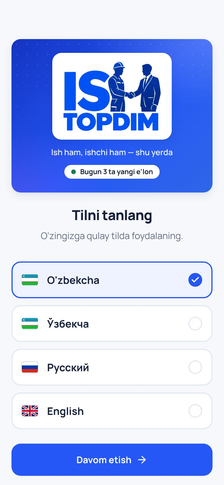

# ISH TOPDIM — "premium" ko'rinish (2026-10, 3-qism)

Egasining so'rovi: kirganda bron qilish mini-ilovasidek bo'lsin; e'lon joylash va CV yaratish tugmalari bo'rtib, yaltirab
tursin; AI qidiruv qimirlab tursin; "AI qilgandek", havaskorona ko'rinmasin — odam kirib, ishonib, ish topadigan darajada
professional bo'lsin; odamlarni jalb qiladigan fishkalar.

## 1. Nima uchun "AI qilgandek" ko'rinardi (oldin)

| Belgi | Misol |
|---|---|
| Hamma narsa bir xil tekis oq karta, och fon, bitta ko'k — brend "yuzi" yo'q | bosh sahifa, kirish ekranlari (`before-*`) |
| Asosiy amallar oddiy havola yoki kichik tugma: "E'lon berish", "CV" ko'zga tashlanmaydi | ish qidiruvchi bosh sahifasi |
| Birinchi ochilish (til, rol) — shablon ko'rinishi: kulrang doira ichida belgi | `before-0-start-*` |
| AI qidiruv — oddiy matnli tugma, "jonli" emas | `before-2-seeker-home-390` |
| Tugmalarda chuqurlik yo'q (tekis to'rtburchak) | butun ilova |

## 2. Nima o'zgardi

> **2026-10-22:** quyidagi yaltiroq tugmalar va kamalak belgilar egasining qarori bilan "toza" uslubga almashtirildi — §6.

**Dizayn qatlami** (`globals.css`, `docs/BRAND_UI_GUIDE.md` §1.1): chuqur ko'k sarlavha sirti (`.hero-surface`), bo'rtib turadigan
tugmalar (`.btn-3d` — barcha asosiy tugmalar), ko'k sirt ustidagi oq tugma (`.btn-light`), yaltirash (`.shine`), aylanib
turadigan AI chegarasi (`.ai-glow`), yaltiroq rangli belgilar (`.badge-*`), ko'tarilgan plitkalar, menyudan bo'rtib chiqadigan
markaziy tugma (`.nav-fab`). Komponentlarda xom gradient/hex hali ham yo'q — brend qo'riqchisi o'zgarmadi; yangi ranglar
kontrast testiga qo'shildi. Radius biroz kattalashdi (zamonaviyroq). Harakat `prefers-reduced-motion` da o'chadi.

**Bosh ekranlar — mini-ilova uslubi:**
- **Ish qidiruvchi:** ko'k sarlavha (salomlashuv ismi bilan, "O'zingizga mos ishni toping", bugungi haqiqiy son), oq qidiruv
  kartasi, **jonli AI qatori** (rangli chegara aylanadi, belgi yaltiraydi, misollar o'zi yozilib-o'chadi) va "Filtrlar";
  sarlavha ustiga chiqib turadigan **8 ta xizmat**: CV yaratish (kirgan bo'lsa — "Mening CV'im"), Kunlik ish, Yaqin atrofda,
  Masofaviy, Tajribasiz, Talabalar, Telegram xabar, Barcha kasblar. Kompyuterda o'ngda haqiqiy raqamlar paneli. Telefonda
  birinchi vakansiya baribir birinchi ekranda (test).
- **Ish beruvchi (panel):** sarlavhada logotip, salomlashuv, tasdiq holati, oq yaltiroq **"Vakansiya joylash"**, jonli AI nomzod
  qidiruvi; xizmatlar: (AI bilan e'lon), Arizalar, Nomzodlar, Kunlik ishchi, Tajribali, Yaqin atrofda, Telegram xabar, Kompaniya.
- **Ish beruvchi (mehmon / profil yo'q):** shu uslubdagi sarlavha va 4 ta xizmat.
- **Pastki menyu:** o'rtada bo'rtib, yaltirab turadigan **"E'lon"** (ish qidiruvchi — o'zi haqida e'lon/CV, ish beruvchi — vakansiya).
  Kompyuterda — yuqori paneldagi yaltiroq "E'lon berish" / "Vakansiya joylash".
- **Mehmon bosh sahifasi:** ko'k sarlavha, sariq urg'uli sarlavha, oq yaltiroq "Ish qidiraman" va shaffof "Xodim qidiraman".
- **Birinchi ochilish:** til ekranida brend kartasi (belgi, "Ish topdim", shior, bugungi haqiqiy son); rol kartalarida yaltiroq
  belgilar; tanishtiruv tasvirlari brend ramkasida; barcha kirish belgilari — "ilova belgisi" uslubida.

**Fishka — "Gapirib bering":** AI bilan rezyume/vakansiya tuzishda yozish shart emas — "Gapirib berish" tugmasi, aytilgani matnga
yoziladi, AI maydonlarni to'ldiradi (brauzer qo'llasa; ovoz serverga yuborilmaydi). AI qidiruvda ham mikrofon bor (2-qism).

### Bosh ekran fonlari (surat)

Ko'k fon o'rniga surat qo'yish mumkin: **admin → Kirish ekranlari → «Bosh ekran fonlari»** — ish qidiruvchi, ish beruvchi,
mehmon (birinchi ochilish ham) uchun alohida. Surat ustiga ko'k parda tushadi (`.hero-scrim`): eng oq surat ustida ham oq yozuv
≥ 5:1, och yozuv ≥ 4.5:1 — matn doim o'qiladi. Kompyuterda yozuv chapda, o'ng tomonda surat ochiqroq ko'rinadi. Surat
yuklanmasa yoki ochilmasa — avvalgi ko'k fon. Mehmon sahifasida surat bo'lsa, ustidagi tasvir kartalari yashiriladi.
Qanday surat va tayyor promptlar: `docs/IMAGE_PROMPTS.md` → «Bosh ekran fonlari». Sinov: `entry-flow.spec.ts`.

## 3. Oldin / keyin (`docs/screenshots/premium-2026-10/`, skript: `e2e/screens/premium.shots.ts`)

| Ekran | Oldin | Keyin |
|---|---|---|
| Til (birinchi ochilish) |  |  |
| Tanishtiruv |  |  |
| Rol |  |  |
| Ish qidiruvchi (telefon) |  |  |
| Ish beruvchi (telefon) |  |  |
| Mehmon (telefon) |  |  |
| Ish qidiruvchi (kompyuter) |  |  |
| Ish beruvchi (kompyuter) |  |  |
| Mehmon (kompyuter) |  |  |

## 4. Keyingi fishkalar (taklif, hali qilinmagan)

1. **Haqiqiy fotosuratlar:** admin → "Kirish ekranlari" va kasb rasmlari (`IMAGE_GEN_API_KEY`) yoqilsa, kartalar va sarlavhalar
   jonli suratlar bilan chiqadi — eng katta "professional" farq. Kalit qo'yilishi kifoya.
2. **"Bugun ish" xaritasi:** kunlik ishlar xaritada (yaqin atrofda) — qurilish, yuk tashish uchun.
3. **Bir bosishda Telegram orqali ariza** va ish beruvchiga darhol xabar (bot bor — oqimni qisqartirish).
4. **Maosh ko'rsatkichi:** "Bu kasb bo'yicha Toshkentda o'rtacha maosh" — faqat bazadagi haqiqiy e'lonlardan.
5. **Ishonch belgilari:** tasdiqlangan kompaniya, "javob beradi" (o'rtacha javob vaqti), shikoyatlar soni.

## 5. Ustma-ust yozuvlar — tuzatish (2026-10-21)

Egasi telefonda: "yozuvlar ustga chiqib ketgan, ba'zi belgilar yozuvni to'sib qo'ygan". Avtomatik audit (`e2e/overlap.ts`,
`e2e/screens/overlap.audit.ts`): 26 sahifa × 11 holat (320–1440 px; uz, oz, ru, en; shrift 1.15–1.25× va telefonning "katta
shrift"i — faqat yozuv 1.3×). Topilgan va tuzatilgan:

| Joy | Muammo | Tuzatish |
|---|---|---|
| Bosh ekran, AI qatori | Tor telefon / katta shriftda "YANGI" belgisi strelka tugmasi ostida qolardi | "Filtrlar" qidiruv kartasi ichiga (telefonda belgi), AI qatori butun kenglikda; joy yetmasa "YANGI" yashiriladi |
| Pastki menyu, "E'lon" | Menyudan yuqoriga chiqib, ostidan o'tayotgan yozuvni to'sardi | Menyu ichida (yaltiroq, bo'rtgan, lekin chiqmaydi) + test |
| E'lon berish, kasb sohalari | "telekommunikatsiya", "программирование" qo'shni plitkaga chiqardi | Nom plitka kengligida, kerak bo'lsa bo'linadi |
| Kabinet, hisoblagichlar | Ruscha katta shriftda "Приглашения" qo'shnisiga chiqardi | Tor joyda 2 ustun |
| Xizmatlar to'ri | 320 px da "Masofavi/y" bo'linardi; ruscha "Уведомления" sig'masdi | < 380 px da biroz kichik shrift; ruscha "В Telegram" |
| Butun sayt | Uzun so'z tor joydan chiqib ketishi mumkin edi | `overflow-wrap: break-word` (asos) |

Natija: audit — 0 muammo. Doimiy test: `e2e/specs/layout-overlap.spec.ts` (3 holat × 9 sahifa, AI oynasi, pastki menyu).

## 6. "Toza" uslub — tugmalar va belgilar (2026-10-22)

Egasi: "zo'r chiqqan, faqat tugmalar — AI qilgani bilinib turibdi, bachkana; avval ko'rsat, keyin qilamiz". Haqiqiy ilova
ustida ikki variant ko'rsatildi (A — tuzilma o'sha, bitta rang; B — 2 katta karta + filtr chiplari), egasi **A** ni tanladi.
Qoidalar: `docs/BRAND_UI_GUIDE.md` §1.1.

| Nima | Oldin | Endi |
|---|---|---|
| Xizmat belgilari | 8 xil kamalak rang, yaltiroq gradient, rangli nur | Bitta brend rangi: och ko'k plita + ko'k chiziqli belgi; asosiysi to'q ko'k |
| Tugmalar (`Button`, qidiruv, AI strelkasi) | 3D: gradient, yorug' chekka, rangli nur | Tekis ko'k, yengil soya |
| "Vakansiya joylash", "Ish qidiraman" (ko'k sarlavhada) | Oq gradient, yaltiraydi | Oq, tekis |
| Yaltirash (`.shine`) | "E'lon", "Vakansiya joylash", "CV" ustidan har 4 s da nur | Yo'q |
| AI qatori | Aylanuvchi kamalak chegara, belgi "sakraydi" | Qidiruv kartasi bilan bir xil oq karta; harakat — faqat o'zi yozilib turadigan misol |
| Pastki menyu "E'lon" | Katta yaltiroq kvadrat, nomi boshqalardan pastda | Ko'k pilyula, hamma nomlar bitta chiziqda |
| Rol kartalari, til ekrani belgisi | Ko'k / binafsha yaltiroq | Rollar — ikkalasi bir xil och ko'k; til ekrani belgisi — tekis ko'k |

Olib tashlangan utilitalar: `.btn-3d`, `.shine`, `.ai-glow`, `.ai-twinkle`, `.badge-glossy`, `.badge-*`, `.nav-fab`
(`--ai-1..3` ranglari ham). Skript: `e2e/screens/clean.shots.ts`.

| Ekran | Oldin | Keyin |
|---|---|---|
| Ish qidiruvchi |  |  |
| Ish beruvchi |  |  |
| Mehmon |  |  |
| Rol |  |  |
| Til |  |  |
