# ISH TOPDIM — interfeys redizayni (2026-10-20)

## 1. Nega oldingi o'zgarish ko'rinmadi — dalillar bilan

| Tekshirilgan narsa | Natija | Dalil |
|---|---|---|
| Oldingi bosqich nimani o'zgartirgan | Faqat backend va testlar: Telegram navbati, 0068 migratsiyasi, zaxira nazorati, audit hujjati. Foydalanuvchi ko'radigan ekranlarda vizual o'zgarish yo'q edi. | `git diff --stat 84e8ba0..2a306ee` — 16 fayl: `notifications/*`, `lib/format`, `supabase/*`, `.github/*`, `docs/*`. `src/components`, `globals.css`, `features/landing`, `find/components` — o'zgarmagan. Yagona UI fayli `cabinet/matches-page.tsx` — maosh davri matni ("/oy"). |
| Egasi qaysi sahifani ko'radi | Kirgan, rol tanlangan foydalanuvchi `/` da **SeekerHome** yoki **EmployerHome** ni ko'radi. Undan oldingi katta bosh sahifa redizayni (`754d924`, marketplace) **MarketHome** ga tushgan — u faqat **rejim tanlamagan mehmonga** ko'rinadi. | `src/features/landing/home-page.tsx`: `if (!mode) return <MarketHome/>`; aks holda `SeekerHome`/`EmployerHome`. `seeker-home.tsx` oxirgi marta 2026-10-16 (`f09db42`) o'zgargan. |
| Parallel eski/yangi sahifa | Ha: bitta `/` uchun uchta komponent (MarketHome, SeekerHome, EmployerHome). Yangilanish birinchisiga tushgan, egasi esa ikkinchisini ko'radi. | yuqoridagi shart |
| Feature flag yoki rol | Flag yo'q. Farqni rejim (`ib_mode` cookie, `profiles.active_role`) beradi. | `features/mode` |
| Preview va production commit | Production (`ishuz` Vercel loyihasi) `main` dan quriladi: `main` = `2a306ee`, deploy muvaffaqiyatli. Branch `claude/gallant-thompson-q70fo3` boshqa Vercel loyihalariga (express-v1…) chiqadi — production emas. | Vercel deploy holati, `git log origin/main` |
| Kesh / service worker | Sabab emas: sahifalar (navigate) har doim tarmoqdan olinadi, faqat `/_next/static` (hash'li) keshlanadi. | `public/sw.js`: `if (req.mode === "navigate") fetch(req)…` |

**Xulosa:** oldingi bosqichda vizual o'zgarish umuman bo'lmagan. Undan avvalgi vizual ish esa egasi ko'rmaydigan sahifaga (rejimsiz mehmon bosh sahifasi) tushgan. Bu safar o'zgarishlar aynan egasi ko'radigan marshrutlarga kiritildi: `/` (ish qidiruvchi va ish beruvchi rejimi), `/search`, kartalar ishlatiladigan barcha ro'yxatlar, umumiy navigatsiya va ranglar.

## 2. Nima o'zgardi (bu bosqich)

### 2.1 Ranglar va tokenlar (COBALT SUN) — butun ilova

- **Asosiy:** primary `#2457F5`, matn `#15213B`, fon `#F6F8FC`, kartalar `#FFFFFF`.
- **Sariq urg'u** `#FFC83D` kam ishlatiladi: faqat TOP belgisi.
- **Kulrang matn:** `#5F6B7F` — kontrast testi `#667085` ni ochiq fonlarda 4.43:1 deb topdi (AA talabi 4.5:1), shuning uchun to'qroq rang olindi.
- **Radiuslar:** 8 px asosida (2/4/6/8/12/14 px). Katta soyalar yo'q.
- **Qo'shimcha joylar:** brauzer paneli rangi, manifest, oflayn sahifa, SVG va PNG belgilar (`public/icons/*`, `favicon.ico` — SVG'dan qayta chizildi) ham yangilandi.

### 2.2 Vakansiya kartasi — `src/features/find/components/result-cards.tsx`

- **Tartib:**
  1. Lavozim (2 qatorgacha).
  2. Maosh davri bilan ("so'm/oy", "so'm/kun"). Kelishiladigan maosh kulrang.
  3. Kompaniya. Logotip o'rnida bosh harf (soxta logotip yo'q). Tasdiq belgisi faqat haqiqatan tasdiqlangan kompaniyada.
  4. Bitta qator: hudud (tuman birinchi; to'liq manzil — `title` va ekran o'qigichida), grafik, tajriba.
  5. Sana (TOP bo'lsa — sariq belgi) va bitta amal: "Qo'ng'iroq" yoki "Ariza yuborish".
- **Saqlash:** alohida bosiladigan tugma, o'ng yuqori burchakda (`aria-pressed`, 44×44 px).
- **Olib tashlangan:** katta rasm va 6–8 ta rangli belgilar.
- **Chekka holatlar:** uzun sarlavha (2 qator va "…"), maoshsiz e'lon, logotipsiz kompaniya — namunaviy ma'lumotda bor.
- **Balandlik:** 390 px da karta ~175 px, qidiruv sahifasida 3 ta karta to'liq ko'rinadi (test bilan tekshiriladi).

### 2.3 Ish qidiruvchi bosh sahifasi — `/` (rejim: ish qidiruvchi)

- **Telefonda ketma-ketlik:**
  1. Yuqori panel: logo, hudud ("📍 Toshkent shahri ▾"), chat, bildirishnomalar.
  2. Sarlavha: "O'zingizga mos ishni toping".
  3. Katta qidiruv "Kasb yoki ish nomi" va unga biriktirilgan qator — "Filtrlar" va "AI bilan qidirish".
  4. Tez filtrlar: Kunlik, Tajribasiz, Masofaviy, Talabalar uchun.
  5. Darhol haqiqiy vakansiyalar ro'yxati.
- **Birinchi ekran:** 390×844 da birinchi vakansiyaning nomi, maoshi va hududi ko'rinadi (E2E test).
- **Qidiruv hududi:** qidiruv eslab qolingan hududda ishlaydi — hudud qidiruv formasiga yashirin maydon sifatida uzatiladi.
- **Olib tashlangan:** katta rasmli plitkalar ("Kunlik ishlar", "Yaqin atrofda" va 5 ta kichik plitka) va statistika banneri.
- **Bo'limlar:** sonlari bilan (MChJ, YaTT, Davlat, Ommaviy, TOP, Yaqin atrofda…) yo'qolmadi. Ular ixcham ro'yxat sifatida ro'yxatdan keyin (telefonda) yoki o'ng panelda (kompyuterda) turadi.
- **Kompyuterda:**
  - tepada keng qidiruv, hudud shu blokda;
  - ro'yxat 2 ustunda;
  - o'ng panel: "O'zim haqimda e'lon", bo'limlar, mashhur kasblar, admin oynalari, AI PRO.
- **Bo'sh holat:** soxta e'lon yo'q — sabab va "O'zim haqimda e'lon berish". Xato holati: "Qayta urinish" va xato kodi.

### 2.4 Navigatsiya

- **Ish qidiruvchining pastki menyusi:** Ishlar · Saqlangan · Arizalar · Profil.
- **Ish beruvchining pastki menyusi:** Boshqaruv · Vakansiyalar · Nomzodlar · Profil.
- **Yuqori panel:** chat va bildirishnomalar. Telefonda avatar takrorlanmaydi — profil pastki menyuda, chiqish kabinetda.
- **Suzuvchi AI tugmasi olib tashlandi.** "AI bilan qidirish" endi qidiruv yonida turadi: ish qidiruvchi va ish beruvchi bosh sahifasida, ish beruvchi panelida va mehmon bosh sahifasida. Admin sozlamasi (yoqish/o'chirish) ishlashda davom etadi.

### 2.5 O'zgarmagan narsalar

Backend, auth, RLS, to'lovlar va biznes qoidalari o'zgarmadi. Migratsiya yo'q.

## 3. Oldin / keyin

Bir xil namunaviy ma'lumot (8 ta vakansiya, bitta tasdiqlangan kompaniya), bir xil rol, til (uz) va o'lcham. Skript: `e2e/screens/redesign.shots.ts`.

| Ekran | 390 px oldin | 390 px keyin | 1440 px oldin | 1440 px keyin |
|---|---|---|---|---|
| Ish qidiruvchi bosh sahifasi | 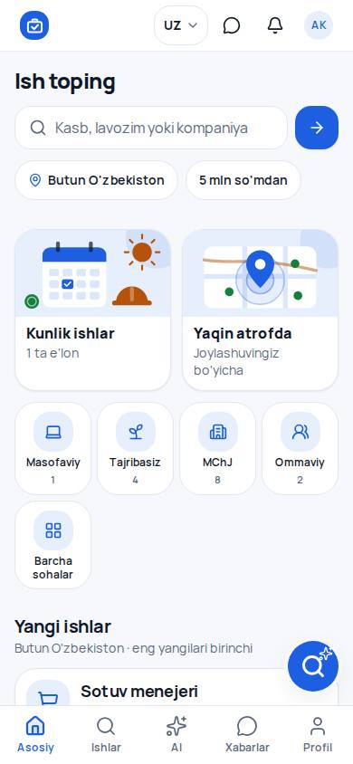 | 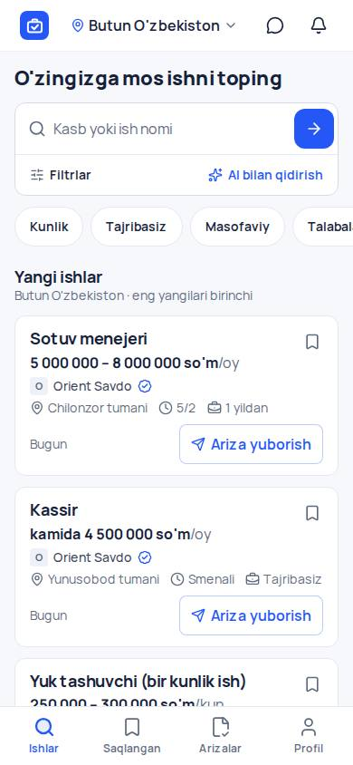 | 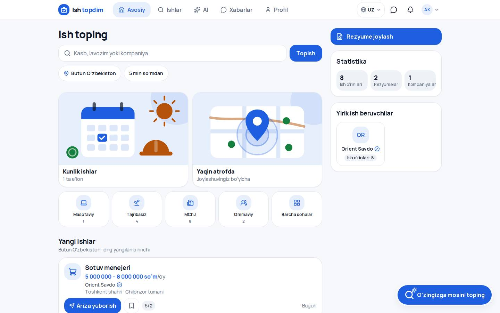 | 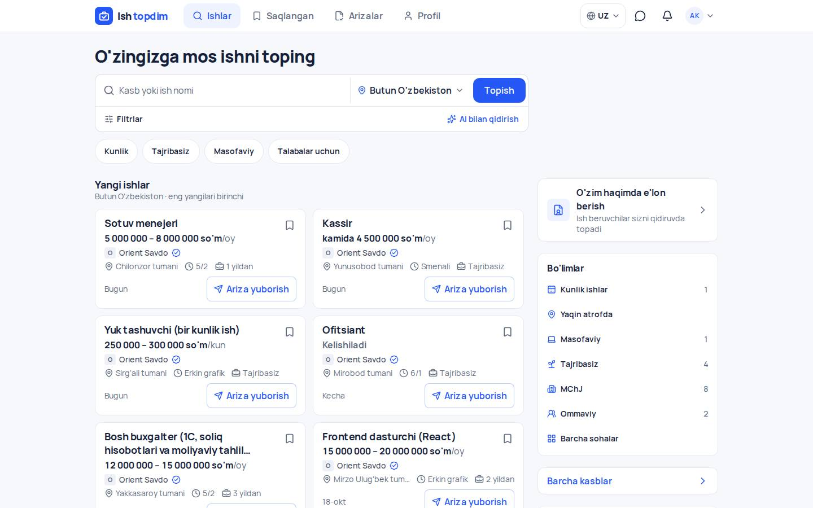 |
| Qidiruv natijalari | 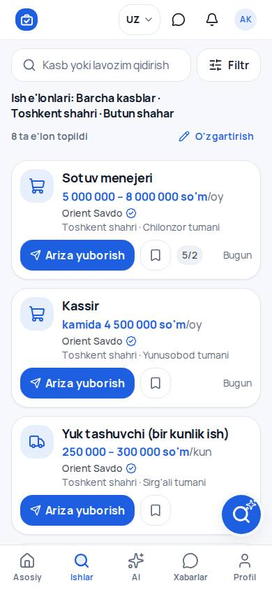 | 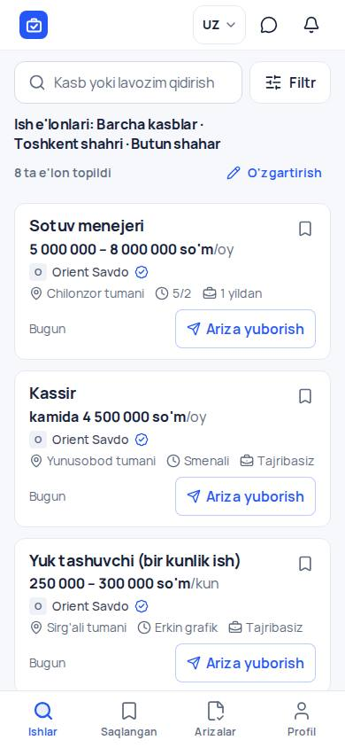 | 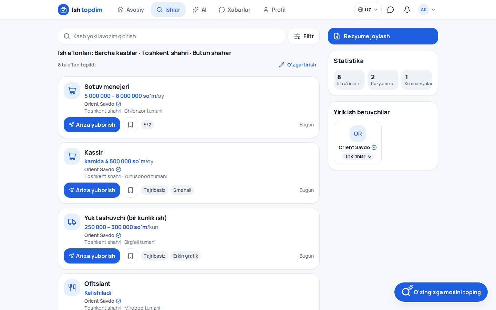 | 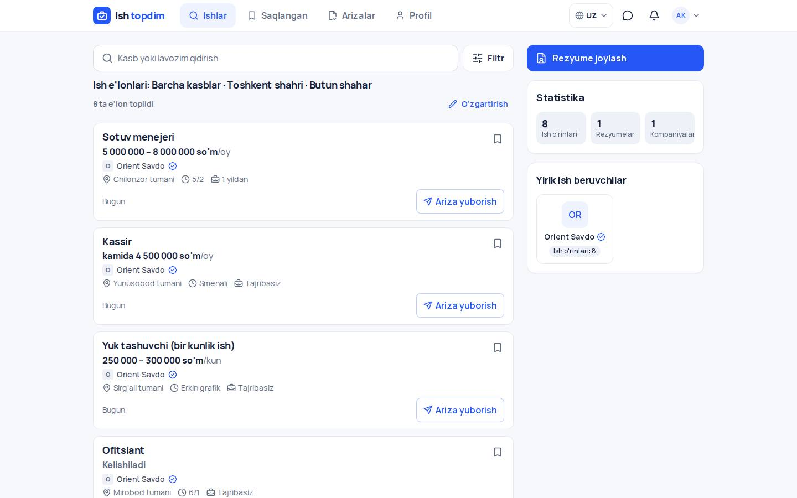 |
| Vakansiya sahifasi | 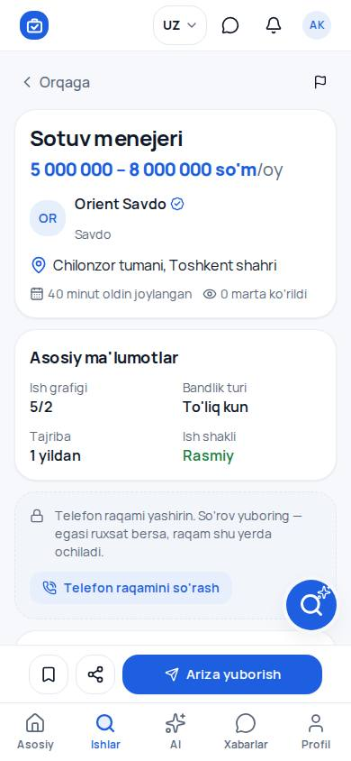 | 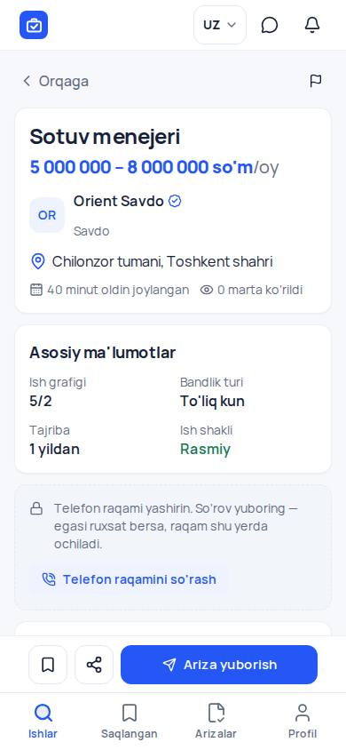 | 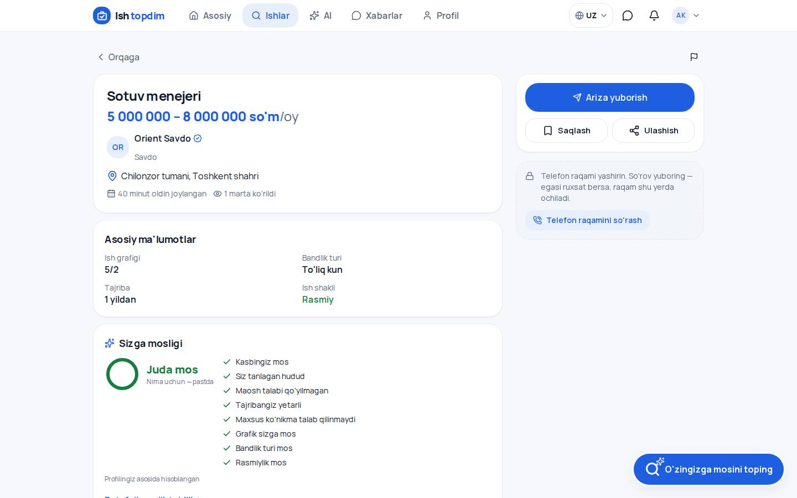 | 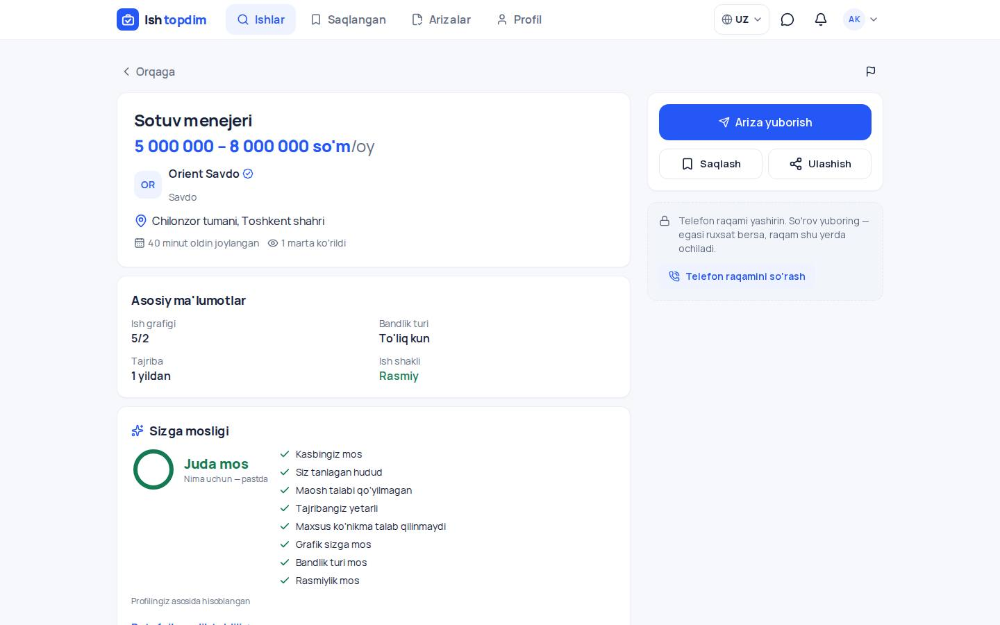 |
| Ish beruvchi bosh sahifasi | 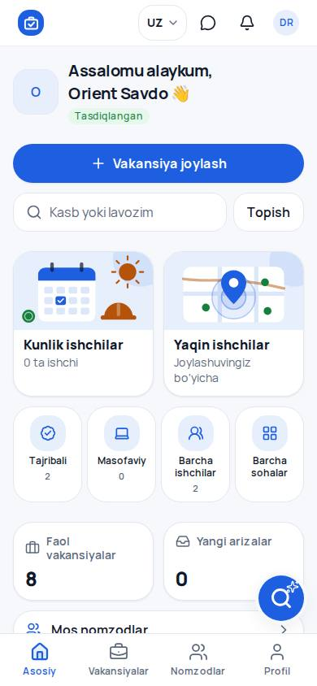 | 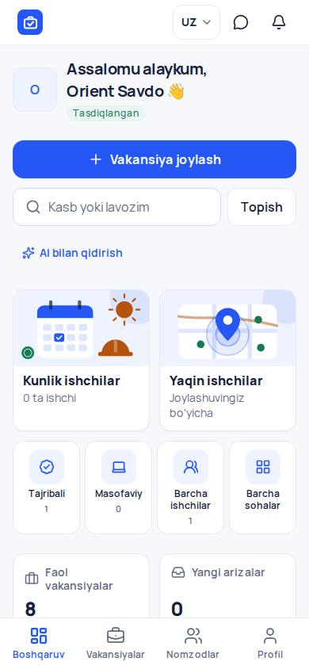 | 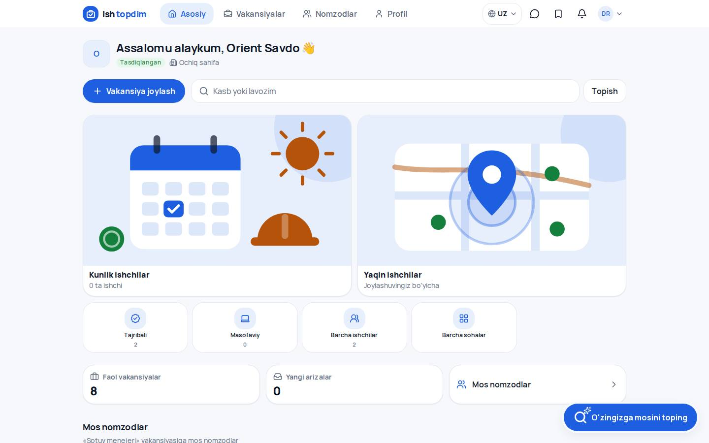 | 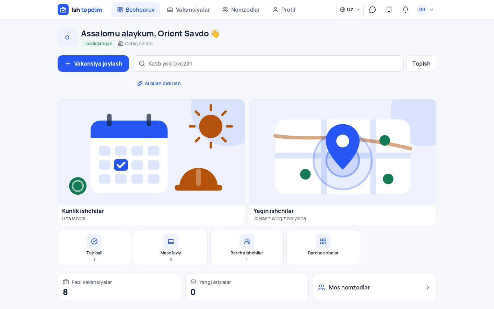 |
| Vakansiya joylash | 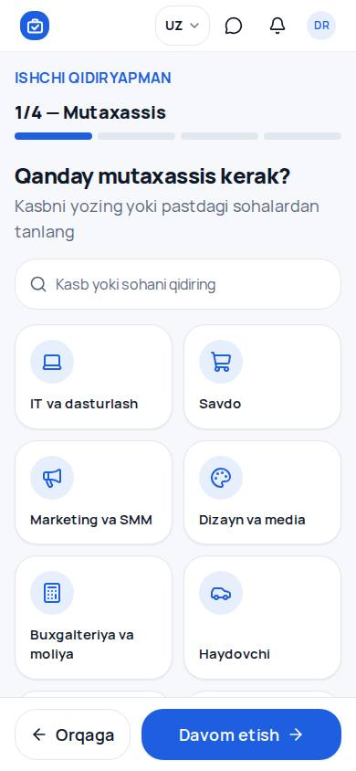 | 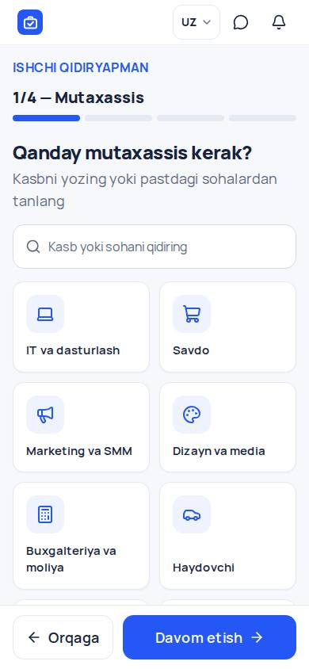 | 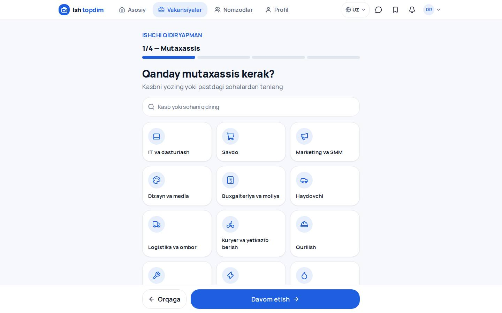 |  |

**Qo'shimcha (faqat keyin):**
- `after-1-seeker-home-ru-390.jpg` — rus tili;
- `after-1-seeker-home-360.jpg` — 360 px;
- `after-6-guest-seeker-home-390.jpg` — mehmon;
- `after-2-search-ru-390.jpg` — qidiruv, rus tili;
- `after-2-search-768.jpg` — planshet.

To'liq sahifa variantlari: `*-full.jpg`.

**Ochiq aytilishi kerak:**
- Vakansiya sahifasi, ish beruvchi bosh sahifasi va vakansiya joylash formasida bu bosqichda faqat ranglar, navigatsiya va AI tugmasi o'zgardi. Ularning tuzilmasi keyingi bosqichlarda qayta quriladi (§5).
- Qidiruv sahifasida yangi kartalar bor. Kompyuterdagi 3 ustunli tuzilma (filtrlar · ro'yxat · tanlangan vakansiya) hali qilinmagan.

## 4. Sinovlar (2026-10-20, lokal izolyatsiyalangan stend)

- **TypeScript:** toza. **Lint:** 0 xato (2 ta eski ogohlantirish — o'zgarmagan fayllarda).
- **Unit:** 678 o'tdi, 18 skip (tashqi xizmat kalitlari kerak bo'lganlar). Shu jumladan:
  - kontrast testi — yangi ranglar ikkala mavzuda ≥ 4.5:1;
  - tez filtrlar tartibi va havolalari;
  - admin rasm joylari ro'yxati.
- **E2E (to'liq, 205 ta):** 203 o'tdi. Yiqilgan 2 tasi olib tashlangan narsani tekshirardi:
  - kartadagi rasm;
  - ish izlovchi bosh sahifasidagi rasmli plitka.

  Ular yangi xulq-atvorga moslandi — kartada rasm yo'q va buzilgan rasm qolmaydi; plitka rasmi ish beruvchi sahifasida tekshiriladi. Shu 4 fayl qayta ishga tushirildi: 41/41 o'tdi.
- **Yangi yoki yangilangan tekshiruvlar:**
  - 390×844 da kirgan ish qidiruvchida birinchi vakansiyaning nomi, maoshi (davri bilan) va hududi pastki menyudan yuqorida;
  - tez filtrlar tartibi Kunlik · Tajribasiz · Masofaviy · Talabalar uchun; "Filtrlar" va "Talabalar uchun" to'g'ri sahifani ochadi;
  - hudud telefonda yuqori panelda;
  - suzuvchi AI tugmasi yo'q; "AI bilan qidirish" qidiruv blokida, sahifa bilan birga siljiydi, vakansiya sahifasidagi "Ariza yuborish" panelini to'smaydi;
  - pastki menyu Ishlar · Saqlangan · Arizalar · Profil va Boshqaruv · Vakansiyalar · Nomzodlar · Profil; 360 px da yozuvlar kesilmaydi;
  - qidiruv sahifasida 390×844 da kamida 3 ta karta to'liq ko'rinadi, 360 px da gorizontal siljish yo'q;
  - bo'limlar (sonlari bazadagi bilan bir xil) ro'yxatdan keyin, rasmsiz;
  - telefonda chiqish kabinetdan, kompyuterda avatar menyusidan.
- **Qo'lda ko'rilgan holatlar** (skrinshotlarda):
  - uzun sarlavha (2 qator, "…");
  - maoshsiz e'lon ("Kelishiladi" kulrang);
  - logotipsiz kompaniya (bosh harf);
  - TOP belgisi; bo'sh ro'yxat; xato holati (kod bilan);
  - tillar: uz va ru; kengliklar: 360, 390, 768, 1440.

### Lokal ishga tushirish

```bash
service postgresql start                     # kerak bo'lsa
bash e2e/stack/up.sh                         # build + lokal Supabase emulyatsiyasi, http://localhost:3300
SHOTS_TAG=after npx playwright test -c e2e/screens/shots.config.ts   # skrinshotlar (docs/screenshots/redesign-2026-10)
npx playwright test -c e2e/playwright.config.ts                     # to'liq E2E
```

### Production holati

**Production (`main`) yangilanmagan.** O'zgarishlar faqat `claude/gallant-thompson-q70fo3` branchida.
- **Preview:** shu branchdan quriladigan Vercel loyihalari (express-v1…) — production emas.
- **Production'ga chiqarish:** `main` ga merge va deploy — egasining alohida ruxsati bilan.
- **Migratsiya:** kerak emas.

## 5. Keyingi bosqichlar (spec bo'yicha)

1. **Qidiruv (kompyuter):** chapda ~260 px filtrlar, ro'yxat, tanlangan vakansiya paneli o'z URL'i bilan (yangilansa saqlanadi). Planshetda kamroq ustun.
2. **Vakansiya sahifasi:**
   - bo'limlar: Vazifalar / Talablar / Sharoitlar / Manzil / Kompaniya;
   - telefonda yopishqoq "Ariza yuborish" va "Saqlash"; ariza yuborilgach — "Ariza yuborilgan";
   - orqaga qaytilganda filtr va scroll saqlanadi.
3. **Ish beruvchi bosh sahifasi:**
   - "Vakansiya joylash", yangi arizalar, ko'rib chiqiladigan nomzodlar, faol vakansiyalar;
   - katta bezak plitkalari olib tashlanadi;
   - kompyuterda jadval, telefonda ixcham kartalar.
4. **Vakansiya joylash:**
   - 3 qadam: Lavozim va hudud → Maosh va shartlar → Tekshirish va joylash;
   - progress, qoralama, haqiqiy karta ko'rinishi, ixtiyoriy AI.
5. **Admin rasm joylari:** ish qidiruvchi plitkalari (`tile_daily_jobs`, `tile_near_jobs`) olib tashlandi — ular endi hech qayerda ko'rsatilmasdi. Ish beruvchi plitkalari ish beruvchi sahifasi qayta qurilganda ko'rib chiqiladi.
