# ISH TOPDIM — AI yordamchi va qulaylik (2026-10, 2-qism)

Egasining so'rovi: dizayn, ketma-ketlik, odamlarga qulaylik, jalb qilish, tugmalar bosilishiga qulay va tushunarli bo'lsin;
AI qidiruvchining shakli va ko'rinishi — dunyo darajasida.

## 1. Audit (o'zgarishdan oldin, lokal stend, 390 va 1440 px)

| Joy | Muammo | Dalil |
|---|---|---|
| AI qidiruv oynasi | Oddiy forma: yordamchining "yuzi" yo'q; natija forma ostiga tushadi — telefonda pastga aylantirish kerak; aniqlashtirib bo'lmaydi; ovoz bilan aytib bo'lmaydi | `before-3-ai-open-390`, `before-4-ai-result-390` |
| AI qidiruv oynasi | Oyna yopilsa (e'lon ochilsa) suhbat yo'qoladi — "Orqaga" bosilganda qaytadan yozish kerak | `ai-finder.tsx`: holat faqat komponent ichida |
| `/ai` sahifasi | "AI yordamchi" deb atalgan, lekin qidiruv AI'ga emas, oddiy `/search` ga olib boradi | `before-5-ai-hub-390` |
| Kirish nuqtasi | "AI bilan qidirish" — kichik matnli havola, ko'zga tashlanmaydi | `before-2-seeker-home-390` |
| Kompyuter, bosh sahifa | Qidiruv yonida katta bo'sh joy | `before-2-seeker-home-1440` |
| Mehmon bosh sahifasi (telefon) | AI chipi tez filtrlar qatorining oxirida — ekrandan tashqarida | `before-1-guest-home-390-full` |
| Mehmon bosh sahifasi | Platformaning farqi (AI) haqida bo'lim yo'q | `before-1-guest-home-1440-full` |
| Bo'sh qidiruv natijasi | AI taklif qilinmaydi | `find-page.tsx` |
| Oyna yopish tugmasi | Bosish maydoni 36×36 (qoida — 44×44) | `dialog.tsx` |

## 2. Nima o'zgardi

### 2.1 AI yordamchi — suhbat ko'rinishi (`features/find/components/ai-chat.tsx`)
- **Yagona belgi** `AiAvatar` (`components/shared/ai-avatar.tsx`): ko'k plita + uchqun; o'ylayotganda yumshoq halqa. Hamma AI joyida bir xil.
- **Salomlashuv va misollar:** bo'sh oynada yordamchi nima qila olishini aytadi; misol bosilsa — darhol so'raladi.
- **Xabarlar:** foydalanuvchi — o'ngda ko'k; yordamchi — chapda, belgi va nom bilan. Kutishda uch nuqta va almashinadigan izoh
  ("So'zlaringizni tushunmoqdaman…" → "Mos e'lonlarni saralamoqdaman…").
- **Javob:** "Tushundim:" + chiplar (kasb, hudud, shartlar), "N ta mos e'lon topdim", haqiqiy kartalar, "Hammasini ko'rish".
  Eski javoblar ixchamlashadi ("Natijalarni ochish") — ro'yxat cho'zilib ketmaydi.
- **Bir bosishda aniqlashtirish:** `+ Kunlik`, `+ Tajribasiz`, `+ Masofaviy`, `+ Smenali` (ishchilar uchun `+ Tajribali`, `+ Masofaviy`).
  Oxirgi so'rovga so'z qo'shiladi; qo'llangan shart qayta taklif qilinmaydi (`aiFind` endi `applied` qaytaradi).
- **Yozish maydoni pastda** (telefonda barmoq yetadigan joy): 4 qatorgacha o'sadi, Enter — yuborish, ostida
  "Faqat bazadagi haqiqiy e'lonlar. Qaror — sizniki."
- **Ovoz bilan:** brauzer qo'llasa (Web Speech API) — mikrofon; aytilgan gap yoziladi va yuboriladi. Til — interfeys tili
  (uz-UZ / ru-RU / en-US). Ovoz serverga yuborilmaydi. Qo'llamasa (masalan, Android WebView) — tugma yo'q.
- **Suhbat saqlanadi** shu tabda 30 daqiqa (`sessionStorage`, xato bo'lsa jim): e'lon ochilib "Orqaga" bosilsa — javob joyida.
  "Yangi suhbat" — tozalash.
- **Oyna o'lchami:** telefonda deyarli to'liq ekran (92 dvh), kompyuterda kengroq (`max-w-2xl`).

### 2.2 Kirish nuqtalari
- Qidiruv blokidagi "AI bilan qidirish" — belgi + qalin matn (44 px).
- **Kompyuter, ish qidiruvchi bosh sahifasi:** ikki ustun — chapda qidiruv va ro'yxat, o'ngda "AI yordamchiga yozing" kartasi
  (yozish maydoniga o'xshash tugma va misollar), keyin avvalgi panel. Bo'sh joy qolmadi. Telefonda birinchi ekran o'zgarmadi
  (birinchi vakansiya ko'rinadi — mavjud test).
- **`/ai` sahifasi:** suhbat sahifaning o'zida; yozish maydoni pastda yopishgan (telefonda pastki menyu ustida).
- **Mehmon bosh sahifasi:** AI chipi tez filtrlar qatorining boshida; "Yangi ishlar"dan keyin yangi bo'lim — "Oddiy so'z bilan
  yozing — AI yordamchi topib beradi": 3 band (faqat haqiqatda bor imkoniyatlar), "AI yordamchini sinab ko'ring" va
  "Namuna" deb belgilangan suhbat namunasi (natija yoki son ko'rsatilmaydi).
- **Bo'sh qidiruv natijasi:** "Yoki oddiy so'z bilan yozing — AI yordamchi boshqacha qidirib ko'radi" + tugma.
- Admin "AI bilan qidirish" tugmasini o'chirsa — karta, bo'lim va bo'sh natijadagi tugma ham yo'q (avvalgidek).

### 2.3 Boshqa
- "AI bilan to'ldirish" (rezyume/vakansiya) sahifalarida ham o'sha belgi.
- Oyna yopish tugmasi — 44×44 bosish maydoni (`tap-target`).
- 4 tilda matnlar (uz, ru, en; kirill `oz` — `scripts/gen-oz-messages.mjs`).

**O'zgarmagan:** backend, baza, RLS, to'lovlar, moslik qoidalari. Migratsiya yo'q. Brend qoidalari (tokenlar, gradient/blur yo'q,
radius va shrift shkalasi) — `brand-guard.test.ts` toza.

## 3. Oldin / keyin (`docs/screenshots/ux-2026-10/`, skript: `e2e/screens/ux.shots.ts`)

| Ekran | 390 oldin | 390 keyin | 1440 oldin | 1440 keyin |
|---|---|---|---|---|
| AI oynasi (bo'sh) | 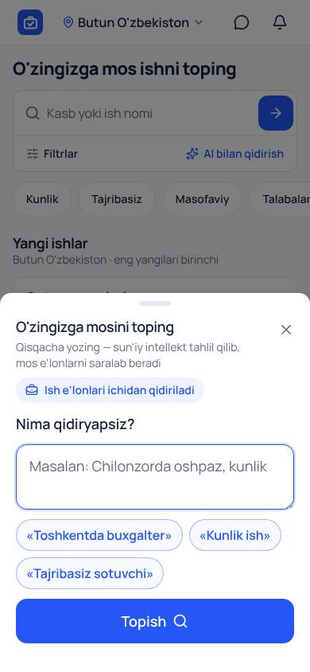 | 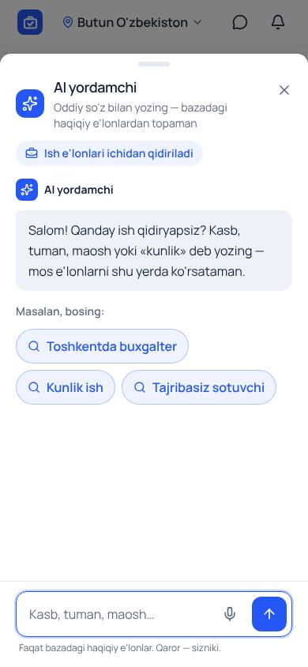 | 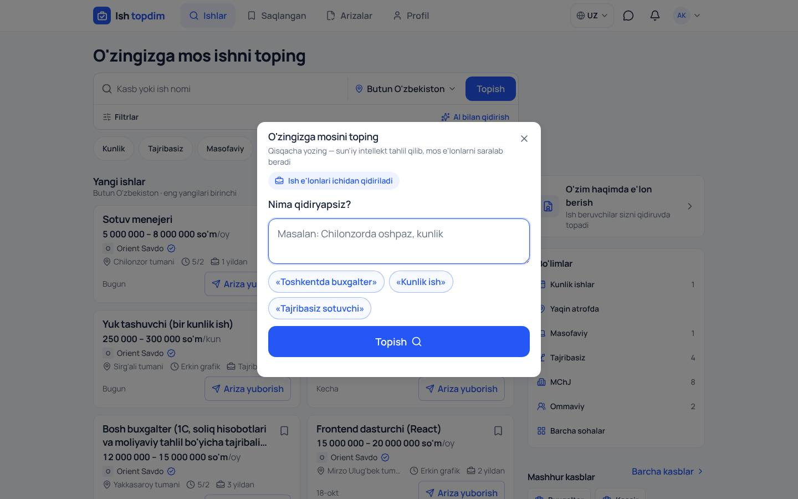 | 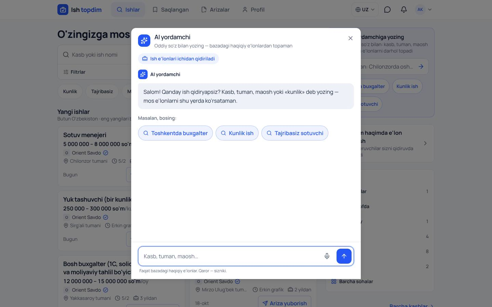 |
| AI javobi | 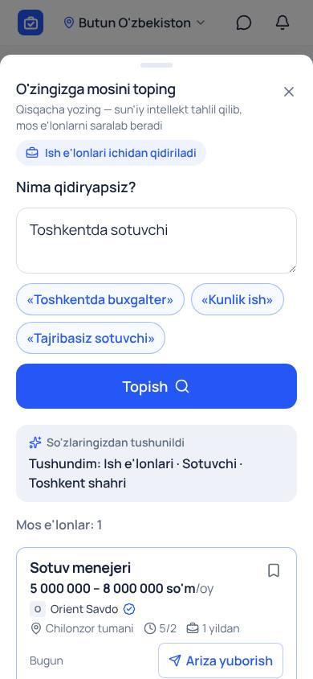 | 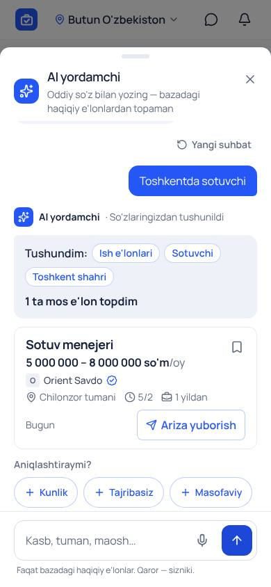 | 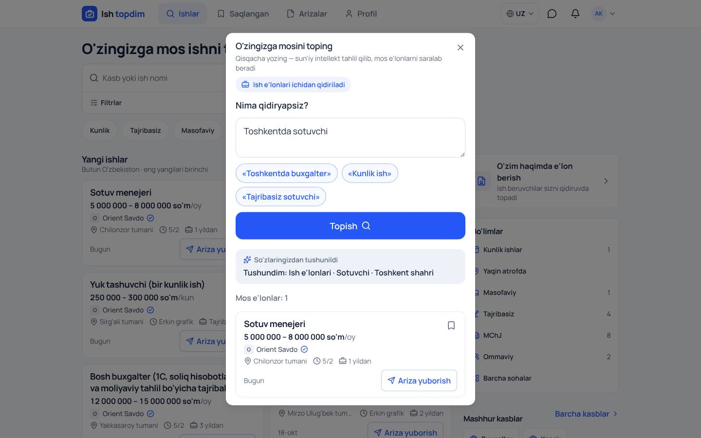 | 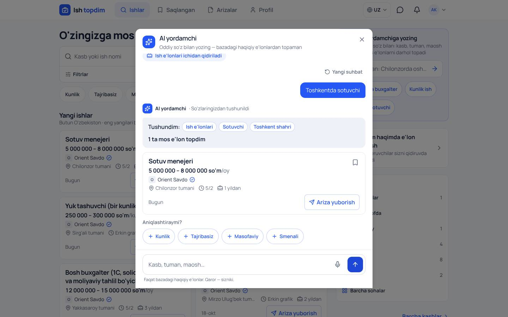 |
| `/ai` | 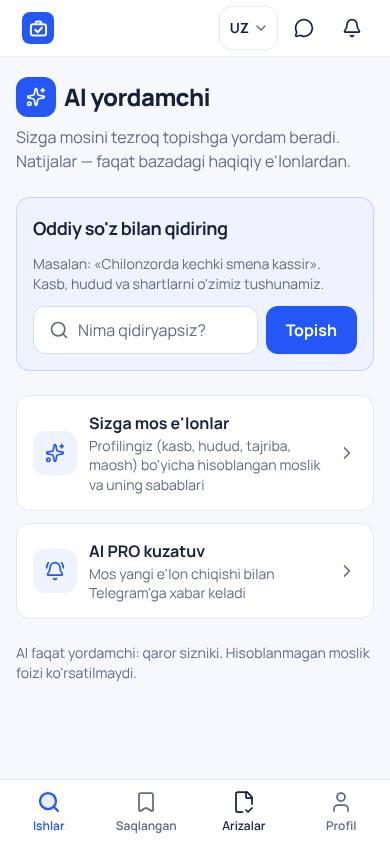 | 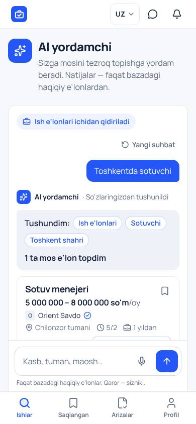 | 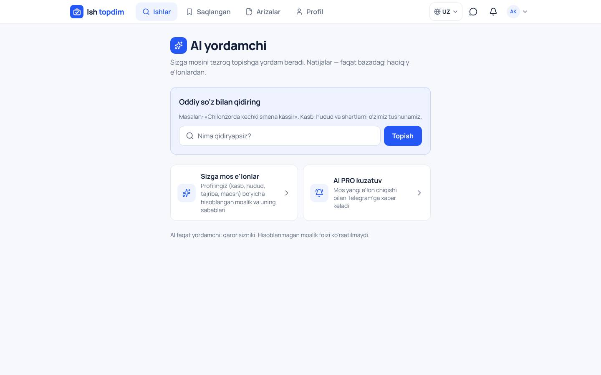 | 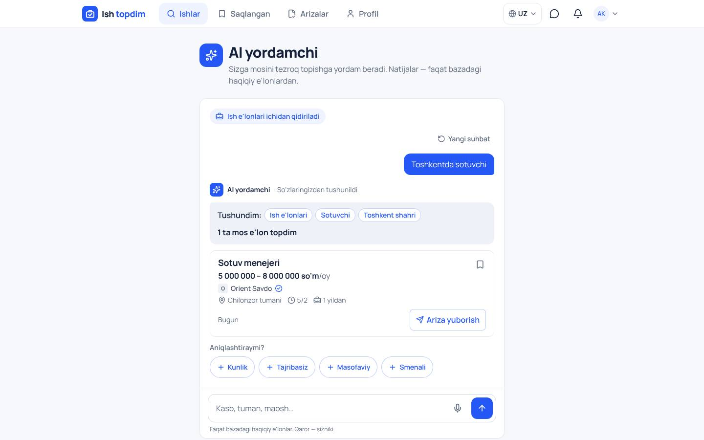 |
| Ish qidiruvchi bosh sahifasi | 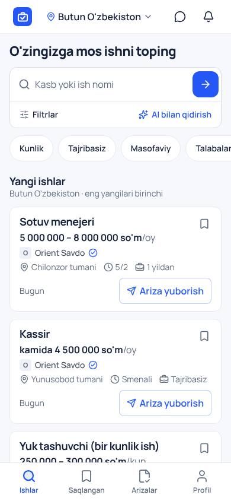 | 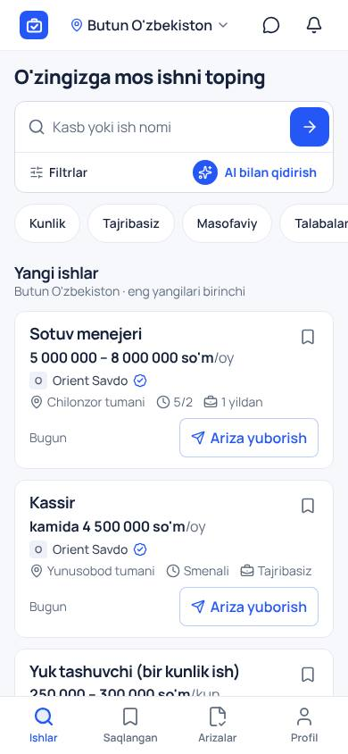 | 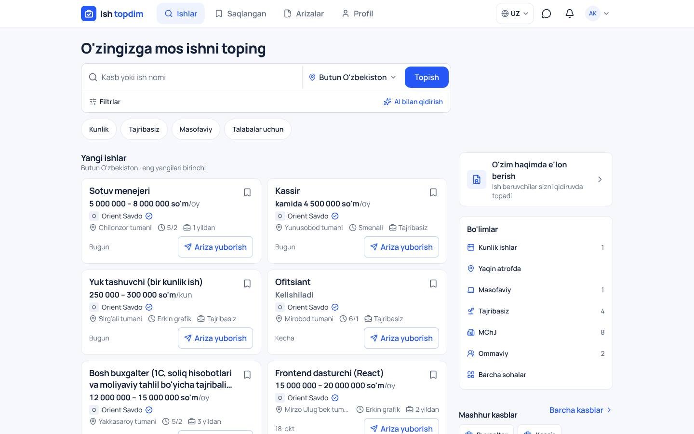 | 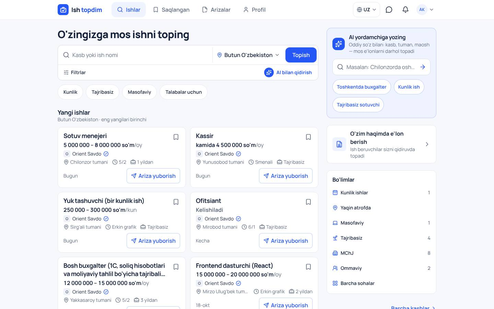 |
| Mehmon bosh sahifasi (to'liq) | 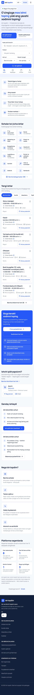 | 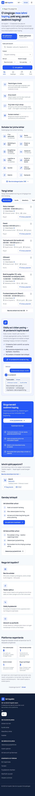 | 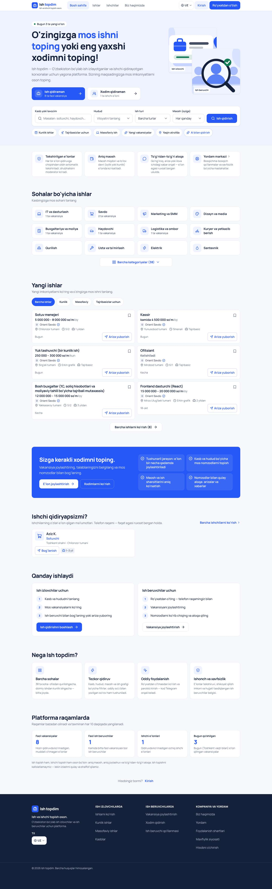 | 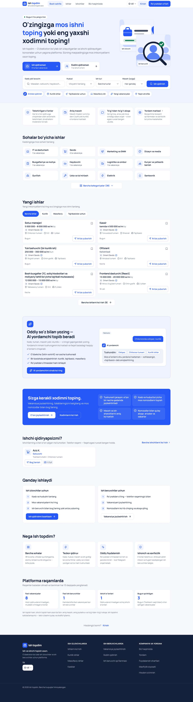 |

Qidiruv, vakansiya va ish beruvchi paneli ham olingan (`*-6-search-*`, `*-7-vacancy-*`, `*-8-employer-home-*`) — ular o'zgarmagan.

## 4. Sinovlar (2026-10-20, lokal izolyatsiyalangan stend)

- **TypeScript:** toza. **Lint:** 0 xato (2 ta eski ogohlantirish — o'zgarmagan fayllarda).
- **Unit:** 684 o'tdi, 18 skip. Yangi: `ai-chat-model.test.ts` — aniqlashtirish takliflari, so'zni qo'shish (takrorlamaslik,
  300 belgi), ovoz tili, saqlangan suhbat (5 ta, 30 daqiqa, buzilgan yozuv).
- **E2E (to'liq, 211 ta):** 209 o'tdi; yiqilgan 2 tasi:
  - `sections.spec.ts` — `/ai` qidiruvi endi `/search` ga emas, suhbatga olib boradi (ataylab). Test yangi xulq bo'yicha yangilandi — o'tadi.
  - `admin-home.spec.ts` — admin panelda rasm tanlash oynasi vaqtida ochilmadi; AI bilan bog'liq emas, qayta ishga tushirilganda o'tdi.
- **Yangi E2E (`ai-finder.spec.ts`):** salomlashuv va misol → javob; `+ Kunlik` faqat kunliklarni qoldiradi va qayta taklif
  qilinmaydi; "Yangi suhbat"; e'lon ochilib "Orqaga" bosilganda suhbat saqlanadi; ovoz (sinov nutq xizmati bilan) — gap yoziladi,
  yuboriladi, til uz-UZ; ovoz qo'llanmasa — mikrofon yo'q; `/ai` — suhbat sahifada, oyna yo'q.
- **a11y:** `/ai` qo'shildi (5 kenglik, axe AA, 44×44, gorizontal siljish yo'q) va qorong'i mavzu kontrasti ro'yxatiga — 24/24 o'tdi.

**Production (`main`) yangilanmagan** — o'zgarishlar alohida branchda, PR orqali.
